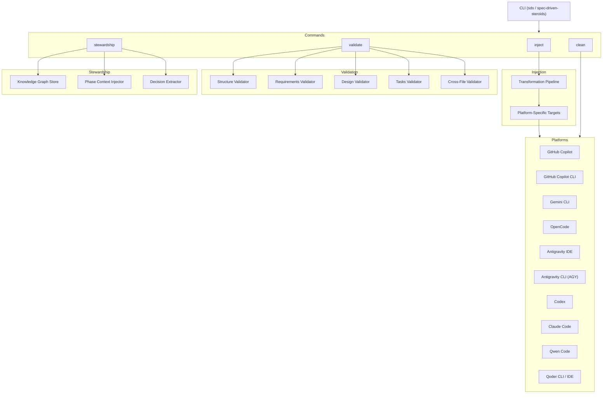
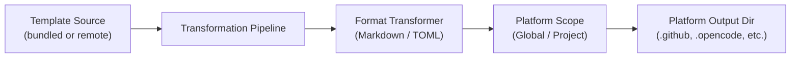
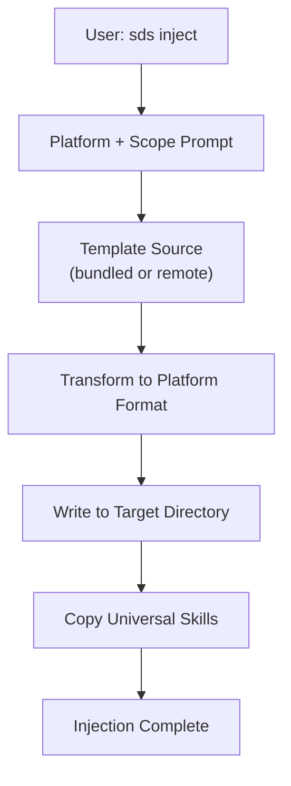

<!-- SpecDriven:managed:start -->

# ARCHITECTURE.md

## High-Level Architecture

Spec-Driven Steroids is a **monorepo CLI tool and template bundle** that injects a Spec-Driven Development workflow into multiple AI coding platforms. It consists of three packages, with the CLI as the single public entry point.



## Package Boundaries

| Package | Scope | Visibility | Key Responsibility |
|---|---|---|---|
| `packages/cli` | Main CLI + templates | **Public** (published to npm) | CLI commands, template injection, validation, knowledge graph |
| `packages/test-utils` | Shared test utilities | **Private** | Mock filesystem, test fixtures |
| `packages/landing-page` | Documentation site | **Private** | Marketing/landing page (Vite) |

## Component Design

### CLI Entry Point (`packages/cli/src/cli/index.ts`)

The CLI uses `Commander.js` for command routing. Commands are registered as subcommands:
- `sds inject` — Interactive platform selection and template injection
- `sds validate <subcommand>` — Spec validation pipeline
- `sds stewardship <subcommand>` — Knowledge graph management
- `sds clean` — Remove globally injected files

### Platform Injection Pipeline



**Key decision**: Platform behavior is centralized in `platform-registry.ts`. Each entry defines display name, supported scopes, transform config, destination resolvers, skills destination, and post-processing. `platform-config.ts` remains the formatting registry consumed by the transformation pipeline. Adding a platform means adding one registry entry plus a table-driven test.

### Install Manifest

Every successful injection writes an install manifest under `~/.config/spec-driven-steroids/installs/` (or `$SDS_CONFIG_DIR`). The manifest records the platform, scope, root, skills root, CLI/template version, and the SHA-256 of every installed file. `clean`, `uninstall`, `doctor`, and `repair` operate from this manifest, which is what prevents SDS from deleting or moving files it does not own.


### Validation Pipeline

The validation system (`packages/cli/src/core/validate/`) provides progressive, composable validation:

```
sds validate structure   → Detect brief/full lane and verify the exact file set
sds validate brief       → Validate compact intent, evidence, tasks, and traceability
sds validate requirements → Validate EARS syntax and REQ-X numbering
sds validate design      → Validate Mermaid syntax and DES-X traceability
sds validate tasks       → Validate phase structure and _Implements tags
sds validate spec        → Auto-detect and validate brief or full spec
```

The injected planner uses a brief lane by default and the existing full lifecycle for high-risk changes. Both lanes require an approved artifact before implementation. Full-lane non-exhaustive discovery runs during task decomposition and is recorded in `tasks.md` before approval.

### Knowledge Graph (Context Stewardship)

The stewardship system (`packages/cli/src/context-stewardship/`) is a file-based JSON knowledge graph for architectural decisions:

| Component | Responsibility |
|---|---|
| `KnowledgeGraphStore` | CRUD operations, conflict detection, version history |
| `ProjectScopedResolver` | Scoped rule resolution with out-of-domain fallback |
| `LifecycleManager` | Rule state transitions (active → deprecated → archived) |
| `SemanticRetrievalEngine` | Token-overlap ranking for retrieval |
| `GracefulDegradationRouter` | Fallback strategy when semantic engine is unavailable |
| `SpecDecisionExtractor` | Extract decision candidates from spec files |
| `PhaseContextInjector` | Inject relevant rules into prompt context per phase |

Rules are stored as JSON files under `~/.agents/stewardship/` with scope isolation. New rules default to `projects/<project-id>` and `global` is an explicit opt-in for rules that are safe across unrelated repositories.

## Architectural Decisions

### AD-1: Monorepo with Single Public Package

The CLI, test utilities, and landing page share a workspace, but only `packages/cli` is published to npm. This keeps toolchain concerns (test fixtures, marketing site) out of the published artifact.

### AD-2: Template Injection Over Plugin Architecture

Rather than requiring each platform to implement an adapter, the CLI transforms universal templates into platform-specific formats at injection time. This centralizes the workflow logic and reduces per-platform maintenance.

### AD-3: File-Based Knowledge Graph

The stewardship store uses flat JSON files instead of a database. This avoids runtime dependencies and keeps the knowledge graph portable, inspectable, and version-controllable. Retrieval resolves project rules before global fallback rules. Writes use a cross-process lock file and atomic temp-file renames to prevent concurrent-write corruption. Scope IDs are sanitized before use as directory names.

### AD-4: Integration-Test-First Strategy

Full CLI workflows are verified through integration tests that exercise real file systems with mocked user input. Unit tests are reserved for isolated, high-risk logic. See [TESTING.md](TESTING.md) for details.

### AD-5: Remote Template Support with Bundled Fallback

The CLI prefers fetching versioned templates from a remote source but falls back to bundled templates when remote retrieval fails. This enables template updates without new releases while ensuring offline capability. Remote bundles are digest-verified, host-restricted, schema/version-checked, time-bounded, and cached by digest.

### AD-6: Manifest-Based Install Ownership

SDS records every file it writes in an install manifest and cleans only owned files. Legacy installs without a manifest fall back to a known-artifact list, and directories are removed only when empty. This replaces directory-level cleanup that could delete user-owned agents, prompts, or workflows.

### AD-7: Single Platform Registry

`platform-registry.ts` is the runtime source of truth for platform identity, scope support, destinations, transform configuration, and post-processing. Prompt choices, injection, cleanup, and reporting all derive from it. No platform-specific path logic belongs in command handlers.


## Data Flow



<!-- SpecDriven:managed:end -->
