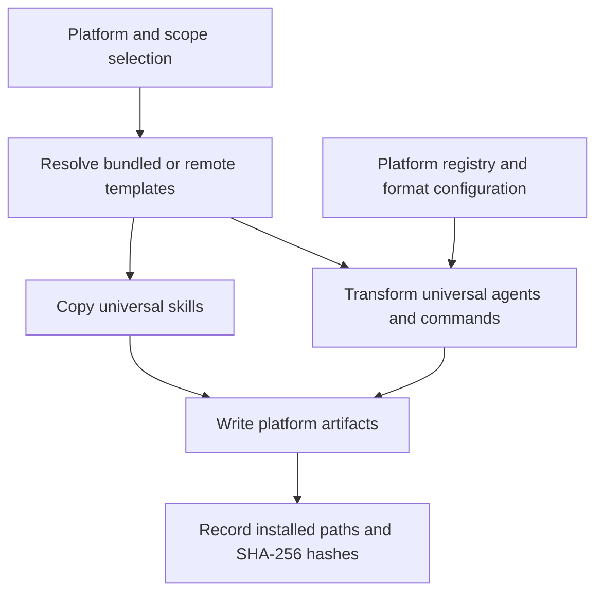

# Architecture

Spec-Driven Steroids is a local Go CLI plus a distributable prompt and skill bundle. It installs instructions into AI coding tools, validates planning artifacts, and stores project-scoped rules. The host AI tool, not the CLI, interprets prompts and performs coding or guideline-generation work.

## Package boundaries

| Package | Visibility | Responsibility |
| --- | --- | --- |
| `cmd/sds` | Entry point | Native binary that wires the command surface |
| `internal/*` | Internal | One Go package per subsystem |
| `packages/cli` | Public: `spec-driven-steroids` | Main npm package: the installer that verifies the platform digest |
| `packages/platform/<os>-<cpu>` | Public | One release package per platform, holding the binary and its digest |
| `packages/landing-page` | Private | Vite site, deployed separately to GitHub Pages |

The CLI is a single Go module at the repository root with no runtime dependency: the canonical artifacts are embedded with the standard library. The TypeScript implementation was removed after the Go suite reproduced the recorded behavior; the fixtures under `internal/testdata/fixtures/` hold that proof and are the regression baseline. The landing page has a separate browser build.

## Implementation boundaries

Paths in this table are relative to `internal/`:

| Package | Responsibility |
| --- | --- |
| `cli/` | Command surface: inject, clean, doctor, repair, uninstall, templates, validate, stewardship, package |
| `cmdr/` | Dependency-free command-line framework whose observable behavior matches the previous `commander` release |
| `config/` | Artifact root resolution and the internal state directories |
| `descriptor/` | Platform descriptors and the descriptor data |
| `emit/` | Canonical and platform-side artifact emission |
| `manifest/` | Installed-file inventory, hashes, and manifest-based cleanup |
| `bundle/` | Remote or bundled source resolution, bundle validation, and cache handling |
| `cleanup/` | Legacy-installation recognition and manifest-driven removal |
| `validate/` | Brief/full structure checks, document validation, traceability, and text/JSON results |
| `stewardship/` | Rule storage, lifecycle, retrieval, scope resolution, and phase-context assembly |
| `pack/` | Portable package rendering, vendor manifests, and marketplace catalogs |
| `serialize/` | Artifact serialization |
| `fsutil/` | Filesystem helpers |
| `assets/` | Embedded canonical artifact tree and the frozen pre-change baseline |
| `version/` | Single version source shared by the binary, the npm package, and the Homebrew formula |

## Artifact root

Every managed artifact lives in the platform-neutral artifact root: `.agents/` inside the working directory at project scope and `~/.agents/` under the home directory at user scope. Both roots use the same internal layout, so a skill installed at user scope and the same skill installed at project scope occupy structurally identical paths.

```text
.agents/
├── skills/<skill-name>/SKILL.md
├── skills/<skill-name>/references/*
├── agents/<agent-name>.md
└── commands/<command-name>.md
```

The user artifact root additionally holds the `stewardship/` subtree that holds the rule graph. Resolution walks from the most specific scope to the least specific, so a project artifact shadows a user artifact of the same name; the resolved artifact set, the layer that supplied each artifact, the effective root, and the written paths are reported by the doctor and inject commands.

A platform that cannot read the artifact root receives a platform-side artifact that carries the same canonical bytes. The CLI owns exactly the paths it records in an install manifest: it never removes a directory it did not create, never rewrites a path it did not write, and never continues upward past the directory that owns a removed file.

## Injection data flow

Injection resolves a template source, transforms universal prompts, copies skills, and records installed files:



The canonical tree lives under `internal/assets/canonical/` and is the single source the binary embeds and the marketplace package ships. The pipeline emits Markdown, TOML, or command skills according to platform configuration. Platform-specific post-processing handles differences such as flattened global prompt paths.

Installed artifacts are copies, not live links to source templates. Editing a repository template does not update an existing global installation until that installation is refreshed.

The `spec-driven-planner` skill owns lane selection and orchestration. Its normative references separate lane selection/transitions from full-lane phases so brief execution need not load the full lifecycle. Agents, commands, and generated entry skills only route to it; skill instructions take precedence over wrappers. Phase skills own their artifact and execution contracts, and shared protocol references supply common validation and context rules. This works without native agents; missing spawning support uses sequential execution and disclosed inline adversarial review, not weaker approval or verification.

## Validation and host execution

The `validate` command supports structure, brief, requirements, design, tasks, whole-spec, and aggregate checks. Full-spec validation combines document checks with cross-file traceability. Aggregate validation can restrict its input to changes relative to a Git ref.

Validation is structural, not a proof that a design meets product needs or that implementation matches it. Mermaid checks are best-effort; they are not a full parser or renderer.

Brief evidence-path coverage and minimum verification-signal checks emit compatibility warnings, not errors. Empty and mixed active lanes are errors; `.archive/` snapshots are inactive. Approval, slicing, recovery adequacy, and scope are host-interpreted contracts, not state inferred or enforced by these structural checks.

The optional planning workflow has a brief lane and a full lane. Their artifacts and approval behavior are described in [README.md](README.md#spec-flow). Those approvals are instructions interpreted by the host agent, not an execution sandbox implemented by the CLI. Likewise, `/inject-guidelines` supplies instructions for document generation; it is not a standalone Markdown generator inside the CLI runtime.

## Persistent state

The CLI uses separate local storage areas:

| State | Location and control |
| --- | --- |
| Installed agent, command, and skill files | The artifact root: `.agents/` at project scope, `~/.agents/` at user scope |
| Install manifests | `installs/` under the resolved config directory; `SDS_CONFIG_DIR` overrides it, otherwise platform/XDG defaults apply |
| Remote template cache | Platform-specific cache directory; overridable with `SDS_TEMPLATE_CACHE_DIR` |
| Rule graph | The `stewardship/` subtree of the user artifact root, `~/.agents/stewardship/` |

Rule storage uses JSON files with lifecycle state, provenance, and version history. Writes use a lock and temporary-file rename. Project identities combine repository/path information to distinguish checkouts; project-scoped retrieval falls back to global rules. Retrieval uses lexical overlap, recency, and confidence, despite the engine's `SemanticRetrievalEngine` name. It does not use embeddings or an external vector database.

Install manifests record paths and file hashes. Cleanup preserves modified tracked files unless forced and removes only empty parent directories. Repair has different semantics: it re-emits platform files and copies skills with overwrite enabled. See [SECURITY.md](SECURITY.md#filesystem-and-local-data) before operating on existing installations.

## Distribution and release boundaries

The public npm package includes compiled CLI output, templates, README, license, and changelog, as declared in `packages/cli/package.json`. The other workspace packages are not published.

Remote templates are preferred by default, with bundled templates as the fallback when remote resolution fails. Bundle schema, version, paths, size limits, compatibility, and optional manifest digest are checked before extraction. A missing digest is accepted with a warning; it is not equivalent to verified remote integrity. Security implications are described in [SECURITY.md](SECURITY.md#remote-templates-and-host-instructions).

Injection, repair, and template inspection pass the same required-skill inventory to source resolution. Fresh remote bundles and hash-valid caches must contain each required `SKILL.md` and the planner's two normative references; missing files cause an `incompatible` fallback to bundled templates with an explicit reason. This presence check prevents missing-contract version skew; it does not prove semantic compatibility or instruction quality.

Distribution has three independent workflows:

- npm publication on `v*` tags, after checking that the tag matches the CLI version
- Template bundle publication on release tags or manual dispatch, updating the `templates-latest` assets
- GitHub Pages deployment for landing-page changes on `main` or manual dispatch

The version is declared once, in the `VERSION` file at the repository root, and every published artifact derives from it. The release script writes that declaration and every place that derives from it. Contribution, direct-delivery, and release responsibilities are documented in [CONVENTIONS.md](CONVENTIONS.md#versioning-and-publishing).
