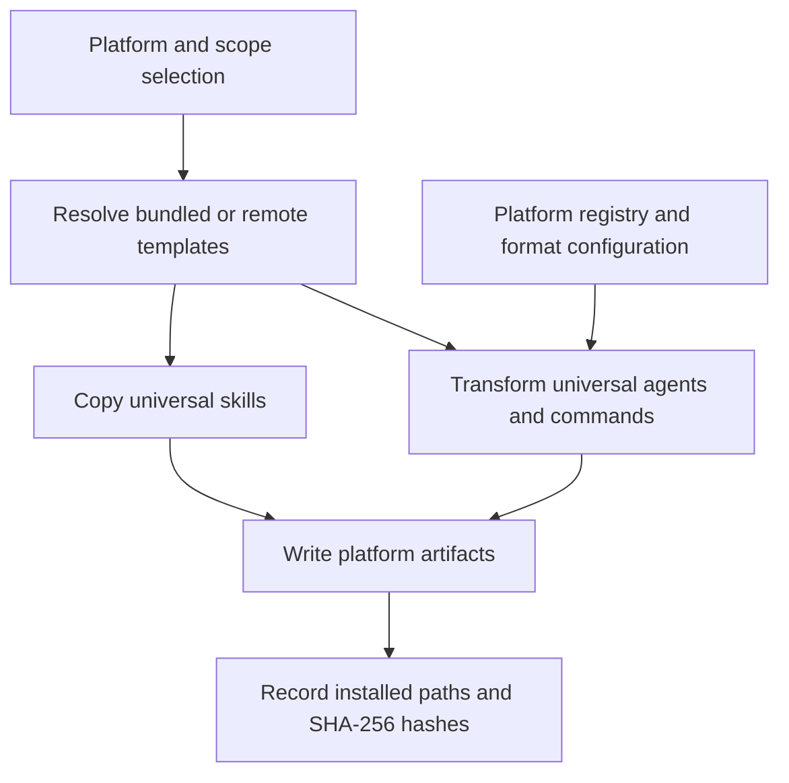

# Architecture

Spec-Driven Steroids is a local Node.js CLI plus a distributable prompt and skill bundle. It installs instructions into AI coding tools, validates planning artifacts, and stores project-scoped rules. The host AI tool, not the CLI, interprets prompts and performs coding or guideline-generation work.

## Package boundaries

| Package | Visibility | Responsibility |
| --- | --- | --- |
| `packages/cli` | Public: `spec-driven-steroids` | CLI commands, validators, rule management, and shipped templates |
| `packages/test-utils` | Private | Shared test fixtures and filesystem helpers |
| `packages/landing-page` | Private | Vite site, deployed separately to GitHub Pages |

The CLI and test utilities compile with TypeScript to native ES modules. The CLI is not bundled: runtime dependencies remain npm dependencies. The landing page has a separate browser build.

## Implementation boundaries

Paths in this table are relative to `packages/cli/src/`:

| Module | Responsibility |
| --- | --- |
| `cli/index.ts` | Commander entry point, injection orchestration, cleanup, and command registration |
| `cli/platform-registry.ts` | Platform identity, scope support, destination resolution, and post-processing selection |
| `cli/platform-config.ts` | File names, output formats, frontmatter, and command-agent mappings |
| `cli/template-source.ts`, `cli/template-bundle.ts` | Remote or bundled source resolution, bundle validation, and cache handling |
| `cli/transformation-pipeline.ts`, `cli/format-transformer.ts` | Universal template transformation into platform artifacts |
| `cli/install-manifest.ts` | Installed-file inventory, hashes, and manifest-based cleanup |
| `commands/manifest-commands.ts` | Doctor, repair, uninstall, and template-source inspection |
| `core/validate/` | Brief/full structure checks, document validation, traceability, and text/JSON results |
| `context-stewardship/` | Rule storage, lifecycle, retrieval, scope resolution, and phase-context assembly |

## Injection data flow

Injection resolves a template source, transforms universal prompts, copies skills, and records installed files:

The source prompts live under `packages/cli/templates/universal/`. The pipeline emits Markdown, TOML, or command skills according to platform configuration. Platform-specific post-processing handles differences such as flattened global prompt paths.

Installed artifacts are copies, not live links to source templates. Editing a repository template does not update an existing global installation until that installation is refreshed.

## Validation and host execution

The `validate` command supports structure, brief, requirements, design, tasks, whole-spec, and aggregate checks. Full-spec validation combines document checks with cross-file traceability. Aggregate validation can restrict its input to changes relative to a Git ref.

Validation is structural, not a proof that a design meets product needs or that implementation matches it. Mermaid checks are best-effort; they are not a full parser or renderer.

The optional planning workflow has a brief lane and a full lane. Their artifacts and approval behavior are described in [README.md](README.md#spec-flow). Those approvals are instructions interpreted by the host agent, not an execution sandbox implemented by the CLI. Likewise, `/inject-guidelines` supplies instructions for document generation; it is not a standalone Markdown generator inside the Node.js runtime.

## Persistent state

The CLI uses separate local storage areas:

| State | Location and control |
| --- | --- |
| Installed agent, command, and skill files | Project or user directories resolved by the platform registry |
| Install manifests | `installs/` under the resolved config directory; `SDS_CONFIG_DIR` overrides it, otherwise platform/XDG defaults apply |
| Remote template cache | Platform-specific cache directory; overridable with `SDS_TEMPLATE_CACHE_DIR` |
| Rule graph | `~/.agents/stewardship/` by default, or `stewardship/` under `SDS_HOME` |

Rule storage uses JSON files with lifecycle state, provenance, and version history. Writes use a lock and temporary-file rename. Project identities combine repository/path information to distinguish checkouts; project-scoped retrieval falls back to global rules. Retrieval uses lexical overlap, recency, and confidence, despite the engine's `SemanticRetrievalEngine` name. It does not use embeddings or an external vector database.

Install manifests record paths and file hashes. Cleanup preserves modified tracked files unless forced and removes only empty parent directories. Repair has different semantics: it re-emits platform files and copies skills with overwrite enabled. See [SECURITY.md](SECURITY.md#filesystem-and-local-data) before operating on existing installations.

## Distribution and release boundaries

The public npm package includes compiled CLI output, templates, README, license, and changelog, as declared in `packages/cli/package.json`. The other workspace packages are not published.

Remote templates are preferred by default, with bundled templates as the fallback when remote resolution fails. Bundle schema, version, paths, size limits, compatibility, and optional manifest digest are checked before extraction. A missing digest is accepted with a warning; it is not equivalent to verified remote integrity. Security implications are described in [SECURITY.md](SECURITY.md#remote-templates-and-host-instructions).

Distribution has three independent workflows:

- npm publication on `v*` tags, after checking that the tag matches the CLI version
- Template bundle publication on release tags or manual dispatch, updating the `templates-latest` assets
- GitHub Pages deployment for landing-page changes on `main` or manual dispatch

Changesets tracks public-package version changes. The root versioning script synchronizes the workspace-root version with the CLI package. Contribution and release responsibilities are documented in [CONTRIBUTING.md](CONTRIBUTING.md#changesets-and-publishing).
